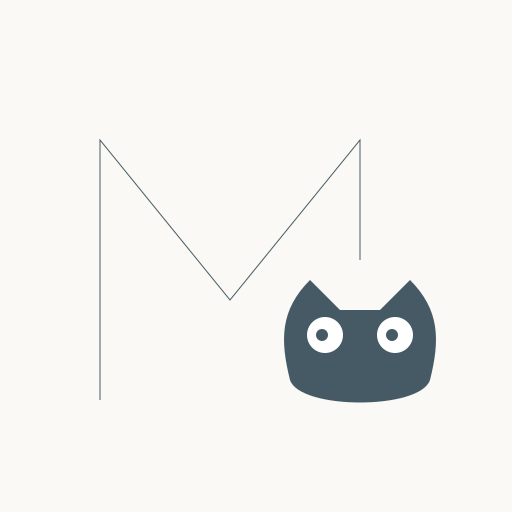

English | [简体中文](https://github.com/Wing900/ManimCat/blob/main/README.zh-CN.md)

<div align="center">

<!-- Top decorative wave -->


<br>



<!-- Cat paw accent -->
<div style="opacity: 0.3; margin: 20px 0;">
  
</div>

<h1>
  <picture>
    
  </picture>
</h1>

<!-- Math symbol divider -->
<p align="center">
  <span style="font-family: monospace; font-size: 24px; color: #90A4AE;">
    ∫ &nbsp; ∑ &nbsp; ∂ &nbsp; ∞
  </span>
</p>

<p align="center">
  <strong>Dual-Mode AI Workspace for Mathematical Visuals</strong>
</p>

<p align="center">
  Combining direct workflow generation with agent-driven studio collaboration, powered by ManimGX and matplotlib
</p>

<!-- Geometric divider -->
<div style="margin: 30px 0;">
  <span style="color: #CFD8DC; font-size: 20px;">◆ &nbsp; ◆ &nbsp; ◆</span>
</div>

<p align="center">
  
  
  
  
</p>

<p align="center" style="font-size: 18px;">
  <a href="#overview"><strong>Overview</strong></a> •
  <a href="#examples"><strong>Examples</strong></a> •
  <a href="#quick-start"><strong>Quick Start</strong></a> •
  <a href="#technology"><strong>Technology</strong></a> •
  <a href="#deployment"><strong>Deployment</strong></a> •
  <a href="#relationship-to-the-original-project"><strong>Relationship</strong></a> •
  <a href="#license-and-copyright"><strong>License</strong></a> •
  <a href="#maintenance-notes"><strong>Maintenance</strong></a>
</p>

<br>

<!-- Bottom decorative wave -->


</div>

<br>

## Overview

I am happy to introduce my new project, ManimCat. It is, after all, a cat.

ManimCat started from the direction of [manim-video-generator](https://github.com/rohitg00/manim-video-generator) and has since been **completely rewritten**; no code from it remains. It is now a full AI-assisted creation system for math teaching visuals rather than a single generation flow.

It is designed for classroom explanation, worked-example breakdowns, and visual reasoning tasks. You can use natural language to generate, modify, rerender, and organize both animated and static teaching visuals with `video` and `image` outputs.

The project is now organized around three clear axes: `dual-mode`, `dual-engine`, and `dual-studio`.

- `Workflow Mode` is for direct generation and rendering when you want fast outputs
- `Agent Mode` is for Studio-based collaborative work with longer-lived sessions, task state, review, and iteration (in development)
- `ManimGX` is used for animation and timeline-based mathematical storytelling
- `matplotlib` is used in Plot Studio for static math visuals, charts, and teaching figures
- `Plot Studio` is the more mature Studio path today for static visual work and iterative editing
- `Manim Studio` is the animation-oriented Studio path and is still at an earlier stage

### Interface

<div align="center">
  
</div>
<p align="center"><sub>Describe what you want, then pick a resolution and output type.</sub></p>

<div align="center">
  
</div>
<p align="center"><sub>Settle the question, the answer, and the structure before generating.</sub></p>

<div align="center">
  
</div>
<p align="center"><sub>Render progress and status.</sub></p>

<div align="center">
  
</div>
<p align="center"><sub>Preview, download, modify, or regenerate.</sub></p>

#### Agent mode

Per-scene conversation, with every tool call in view.

<div align="center">
  
  
</div>

<details>
<summary>Settings and prompts</summary>

<br />

<div align="center">
  
  
</div>

</details>

## Examples

<div align="center">

> *Prove that $1/4 + 1/16 + 1/64 + \dots = 1/3$ using a beautiful geometric method, elegant zooming, smooth camera movement, a slow pace, at least two minutes of duration, clear logic, a creamy yellow background, and a macaroon-inspired palette.*

<br>

<a href="https://github.com/user-attachments/assets/112975af-8e6e-4b3a-ab3c-761778ab7049">
  <video src="https://github.com/user-attachments/assets/112975af-8e6e-4b3a-ab3c-761778ab7049" width="85%" autoplay loop muted playsinline>
  </video>
</a>

<sub>▲ Geometric Series Proof · ManimCat</sub>

</div>

## Quick Start

```bash
npm install
cd frontend && npm install
cd ..
npm run dev
```

Open `http://localhost:3000`. See [`.env.example`](.env.example) for environment variables and [Deployment](#deployment) below for deployment notes.

If you want a direct Docker deployment path, you can also start from the published image `wingflow/manimcat` instead of building locally first. Local animation rendering uses [ManimGX 0.1.1](https://github.com/academa-labs/manimgx) and requires Python 3.13 or newer. The Linux wheel includes lavapipe for CPU rendering.

ManimGX uses native Typst typesetting, so local rendering needs no external TeX installation. Typst supports Chinese text and mathematics in the same expression.

For local rendering, create a Python 3.13+ virtual environment, install dependencies with `python -m pip install -r requirements.txt`, then set `MANIMGX_PYTHON` to that environment's Python executable so the app can use the renderer.


## Technology

### Tech Stack

- Product structure: Workflow mode for direct generation, Agent mode for Studio-based collaborative work
- Visual engines: ManimGX for animation, `matplotlib` for Plot Studio static figures
- Backend: Express + TypeScript, Bull + Redis, OpenAI-compatible upstream routing, Studio agent runtime, optional Supabase persistence (CatKey validation, usage records, Studio sessions)
- Frontend: React 19, Vite, Tailwind CSS, classic generator UI, Studio workspace shell, Plot Studio minimal workspace UI, canvas (canvas 2D + perfect-freehand)
- Agent state model: session / run / task / work / result lifecycle for longer-lived studio interactions
- Realtime layer: polling for Workflow jobs, Server-Sent Events for Agent sessions, permission requests, and task updates
- Rendering runtime: Python 3.14, ManimGX 0.1.1 (Typst typesetting), `matplotlib` 3.10.8, `ffmpeg`, `edge-tts` 7.3.1; ManimGX bundles fonts and typesetting
- Retrieval: `onnxruntime-web` + MiniLM local embeddings for Manim / matplotlib API context
- Deployment: Docker / Docker Compose, Hugging Face Spaces

### Workflow Mode

```mermaid
flowchart LR
    classDef ui fill:#F6F7FB,stroke:#455A64,color:#263238,stroke-width:1.2px;
    classDef logic fill:#FFF8E1,stroke:#A1887F,color:#4E342E,stroke-width:1.2px;
    classDef api fill:#E8F5E9,stroke:#5D8A66,color:#1B4332,stroke-width:1.2px;
    classDef state fill:#E3F2FD,stroke:#5C6BC0,color:#1A237E,stroke-width:1.2px;
    classDef output fill:#FCE4EC,stroke:#AD5C7D,color:#6A1B4D,stroke-width:1.2px;

    U[User prompt] --> P1
    P1[Classic UI] --> P2[Problem framing]
    P1 --> P3[Generate / Modify requests]
    P2 --> A1[Workflow APIs]
    P3 --> A1
    A1 --> R1[Upstream routing + AI generation]
    R1 --> C1[Render failure retry / patch loop]
    C1 --> B1[Queue + job state]
    B1 --> B2[Render pipeline]
    B2 --> O1[Video / images / code / timings]
    P1 -. polling / cancel .-> B1
    O1 --> P1

    class P1 ui;
    class P2,P3,R1,C1 logic;
    class A1 api;
    class B1,B2 state;
    class O1 output;
```

### Agent Mode

```mermaid
flowchart LR
    classDef ui fill:#F6F7FB,stroke:#455A64,color:#263238,stroke-width:1.2px;
    classDef runtime fill:#FFF8E1,stroke:#A1887F,color:#4E342E,stroke-width:1.2px;
    classDef api fill:#E8F5E9,stroke:#5D8A66,color:#1B4332,stroke-width:1.2px;
    classDef state fill:#E3F2FD,stroke:#5C6BC0,color:#1A237E,stroke-width:1.2px;
    classDef event fill:#FCE4EC,stroke:#AD5C7D,color:#6A1B4D,stroke-width:1.2px;

    U[User instruction] --> S1
    S1[Studio UI] --> A1[Session / run APIs]
    A1 --> R1[Studio runtime service]
    R1 --> K1[Manim Studio / Plot Studio]
    K1 --> G1[Builder, Designer, Reviewer]
    G1 --> T1[Tools, skills, render / review actions]
    R1 --> S2[Session / run / task / work state]
    R1 --> E1[SSE events + permissions]
    S2 --> S1
    E1 --> S1

    class S1 ui;
    class A1 api;
    class R1,K1 runtime;
    class G1,T1,S2 state;
    class E1 event;
```

## Deployment

### Hugging Face Spaces (Docker)

Use the repository's `Dockerfile`, listening on port `7860`. Its startup script launches embedded Redis; Docker Compose is not needed inside the Space.

Configure environment variables in Space Settings. Store sensitive values in Secrets, never in the repository, Dockerfile, or frontend:

| Configuration | Purpose |
| --- | --- |
| `STUDIO_DATA_MODE=client` | Single-instance deployment with browser-owned sessions |
| `STUDIO_EVENT_TRANSPORT=redis`, `STUDIO_RUN_COORDINATION=redis` | Event delivery and run coordination |
| `SUPABASE_URL`, `SUPABASE_SERVICE_ROLE_KEY` | CatKey validation and usage recording when CatKey is enabled; the Service Role Key stays server-side |
| `CATKEY_UPSTREAM_URL`, `CATKEY_UPSTREAM_API_KEY`, `CATKEY_UPSTREAM_MODEL` | Fixed OpenAI-compatible server upstream when CatKey is enabled |

BYOK users configure their upstream in the UI. For server-side Studio session persistence, set `STUDIO_DATA_MODE=server` and `ENABLE_STUDIO_DB=true`, and configure Supabase with the required tables. Multiple replicas also require shared Redis and accessible render-file storage.

Before syncing to Spaces, commit the changes to publish on `main`, then run:

```powershell
./scripts/sync-space.ps1
```

A `docker-compose.yml` is also provided: Compose runs Redis as its own service and starts the app with `node dist/server.js`; set the host port with `MANIMCAT_PUBLISHED_PORT`, and `--scale` for multiple replicas.

On Linux/macOS, run `bash scripts/sync-space.sh`. By default, the script publishes committed `main` to the `space` and `space-show` remotes, overwriting their remote `main`; check the remote URLs first. It injects Space metadata. Uncommitted changes are excluded from the deployment snapshot.

Deployment notes:

- Without persistent storage, treat container videos, workspaces, and Redis data as temporary: rebuilds may remove them. Database-backed sessions do not preserve video files.
- Run `npm audit --omit=dev` and address security findings before public deployment. After startup, check `/health`, then verify a real model request and video playback.
- Local Docker checks covered the web UI, Manim (Typst typesetting, no external TeX), Chinese text, Matplotlib, MiniLM inference, Edge TTS synthesis, and subtitle burn-in. HF hosting, CatKey, and Supabase integration still require verification after deployment.

## Relationship to the Original Project

This project has been **completely rewritten** and no longer inherits any code from [manim-video-generator](https://github.com/rohitg00/manim-video-generator).

The code and the approach are now completely different, but I am still grateful to the original author for the initial idea and the code prototype.

## Shipped: Workflow Mode

Workflow mode is the current main path: describe what you want in natural language and get a playable video or a usable image.

### Generation pipeline

- Natural language → editable planning card → Manim code → render; planning failures can be retried, including format-repair retries
- Two-stage generation: a concept designer produces the scene plan, a code generator produces the code
- Render failures are fed back to the model automatically; re-rendering from existing code, AI-assisted edits, cancellation, and stage timings are supported
- Video and image output, with `YON_IMAGE` anchor chunking for multi-image runs
- Reference images: upload, or draw them on the canvas (freehand, shapes, function plots)

### Canvas

- Freehand drawing (perfect-freehand strokes), eraser, selection
- Shapes: circle, ellipse, line segment, arrow, rectangle, triangle, polyline polygon, text
- Function plots: expression plus x / y ranges with live preview
- Undo / redo, multi-page documents, export whole pages as 1600×900 reference images

### Narration and subtitles

- Edge TTS synthesis aligned to sentence-level cues
- Soft subtitle track; optional burned-in hard subtitles on download
- Re-renders reuse the published audio track instead of synthesizing again

### Workspace

- Pre-generation planning and prompt template management (including narration prompts)
- CatKey / BYOK connection flows; failures jump straight back to the matching form
- Light / dark themes, a 2048 game for long waits, and a stage-timing panel

## In Development: Agent Mode

Agent mode is not an add-on to Workflow; it is a separate Studio runtime that is still under development.

The goal here is to think about and explore a way of *making* mathematical animation, not merely rendering out a single video.

- Long-lived state model built around Session / Scene / Run / Render
- A single builder agent with a workspace toolset (read, write, edit, glob, grep, ls, API search) and two render tools (manim / matplotlib)
- Server-Sent Events streaming text deltas, tool calls, and render status
- Two workspaces: Plot Studio (matplotlib static figures) is usable but early; Manim Studio is earlier still

## License and Copyright

The current version of this repository is licensed under **AGPL-3.0-or-later**. See `LICENSE` for the full text.

- Third-party attribution and notices: `THIRD_PARTY_NOTICES.md`
- Chinese third-party notices: `THIRD_PARTY_NOTICES.zh-CN.md`
- Contribution guide: `CONTRIBUTING.md`

### Historical Versions

ManimCat early versions included code from `manim-video-generator` (MIT). Historical commits and historical releases remain governed by the license terms that were published with those versions. The current version has removed or independently rewritten the corresponding implementations.

## Maintenance Notes

Because my time is limited and I am an independent hobbyist rather than a full-time professional maintainer, I currently cannot provide fast review cycles or long-term maintenance for external contributions. Pull requests are welcome, but review may take time.

If you have good suggestions or discover a bug, feel free to open an Issue for discussion. I will improve the project at my own pace. If you want to make large-scale changes on top of this work, you are also welcome to fork it and build your own version.

If this project gave you useful ideas or helped you in some way, that is already an honor for me.

<details>
  <summary><b>If you like this project, you can also buy the author a Coke 🥤</b></summary>
  <br />
  <p>Mainland China:</p>
  
  <br />
  <p>International:</p>
  <a href="https://afdian.com/a/wingflow/plan" target="_blank">
    
  </a>
  <p><i>Thank you. Your support gives me more energy to keep maintaining the project.</i></p>
</details>

## Star History

[](https://www.star-history.com/?repos=Wing900%2FManimCat&type=date&legend=top-left)

## Acknowledgements

- [rohitg00/manim-video-generator](https://github.com/rohitg00/manim-video-generator)
- [anomalyco/opencode](https://github.com/anomalyco/opencode)
- [academa-labs/manimgx](https://github.com/academa-labs/manimgx)
- [Linux.do](https://linux.do)
- [Alibaba Cloud Bailian](https://bailian.console.aliyun.com)



