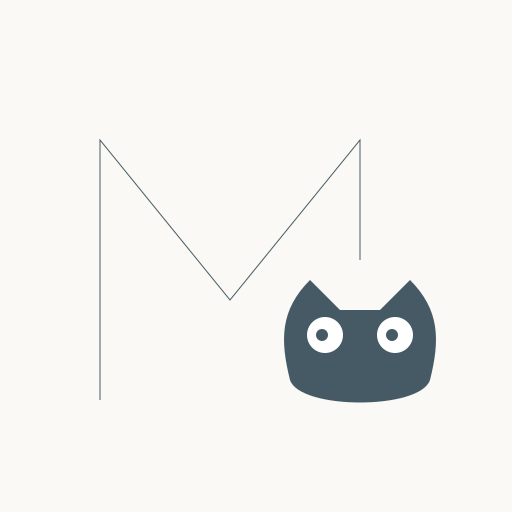
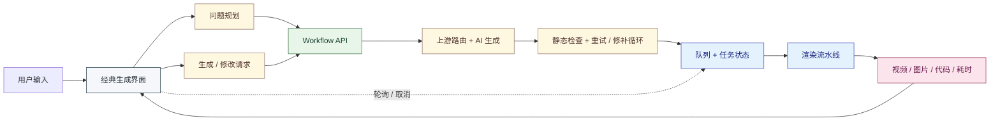
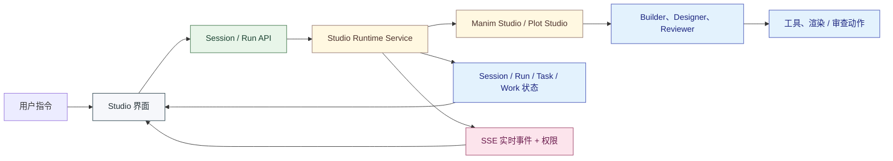

简体中文 | [English](https://github.com/Wing900/ManimCat/blob/main/README.md)

<div align="center">

<!-- 顶部装饰线 - 统一为深灰色调 -->


<br>



<!-- 装饰：猫咪足迹 -->
<div style="opacity: 0.3; margin: 20px 0;">
  
</div>

<h1>
  <picture>
    
  </picture>
</h1>

<!-- 装饰：数学符号分隔 -->
<p align="center">
  <span style="font-family: monospace; font-size: 24px; color: #90A4AE;">
    ∫ &nbsp; ∑ &nbsp; ∂ &nbsp; ∞
  </span>
</p>

<p align="center">
  <strong>面向数学可视化创作的双模式 AI 工作台</strong>
</p>

<p align="center">
  同时支持直接生成工作流与基于 Agent 的 Studio 协作，并由 ManimGX 与 matplotlib 双引擎支撑
</p>

<!-- 装饰：几何点阵分隔 -->
<div style="margin: 30px 0;">
  <span style="color: #CFD8DC; font-size: 20px;">◆ &nbsp; ◆ &nbsp; ◆</span>
</div>

<p align="center">
  
  
  
  
</p>

<p align="center" style="font-size: 18px;">
  <a href="#项目简介"><strong>项目简介</strong></a> •
  <a href="#样例"><strong>样例</strong></a> •
  <a href="#快速开始"><strong>快速开始</strong></a> •
  <a href="#技术"><strong>技术</strong></a> •
  <a href="#部署"><strong>部署</strong></a> •
  <a href="#与原项目的关系"><strong>与原项目的关系</strong></a> •
  <a href="#开源与版权声明"><strong>版权</strong></a> •
  <a href="#维护说明"><strong>维护</strong></a>
</p>

<br>

<!-- 底部装饰线 - 统一为深灰色调 -->


</div>

<br>

## 项目简介

很荣幸在这里介绍我的新项目ManimCat，它是~一只猫~

本项目最初以 [manim-video-generator](https://github.com/rohitg00/manim-video-generator) 的方向为起点，现已**完全重写**，不再包含它的任何代码。今天它是一个完整的 AI 数学教学可视化创作系统，而不只是一条生成流程。

它面向课堂讲解、例题拆解与数形结合表达等场景，用户可以通过自然语言生成、修改、重渲染并组织动画与静态两类教学可视化内容，支持 `video` 与 `image` 两种输出。

项目现在可以从三个维度理解：`双模式`、`双引擎`、`双 Studio`。

- `Workflow Mode` 用于直接生成与渲染，适合快速产出
- `Agent Mode` 用于基于 Studio 的协作式创作、审阅、任务跟踪与迭代（开发中）
- `ManimGX` 负责动画、镜头与时间线驱动的数学叙事
- `matplotlib` 负责 Plot Studio 中的静态数学图像、函数图、图表与教学插图
- `Plot Studio` 是目前更成熟的 Studio 路径，主要面向静态可视化与迭代编辑
- `Manim Studio` 面向动画创作，但目前仍处于相对更早期的阶段

### 界面

<div align="center">
  
</div>
<p align="center"><sub>描述需求，选择分辨率与输出类型。</sub></p>

<div align="center">
  
</div>
<p align="center"><sub>生成前整理问题、答案与讲解结构。</sub></p>

<div align="center">
  
</div>
<p align="center"><sub>渲染进度与状态。</sub></p>

<div align="center">
  
</div>
<p align="center"><sub>预览、下载、修改与重新生成。</sub></p>

#### Agent 模式

分场景对话，工具调用全程可见。

<div align="center">
  
  
</div>

<details>
<summary>设置与提示词</summary>

<br />

<div align="center">
  
  
</div>

</details>

## 样例

<div align="center">

> *$1/4 + 1/16 + 1/64 + \dots = 1/3$，证明这个等式，美丽的图形方法，优雅的缩放平稳镜头移动，慢节奏，至少两分钟，逻辑清晰，奶黄色背景，马卡龙色系*

<br>

<a href="https://github.com/user-attachments/assets/f7e5050a-b49b-488f-b036-216b20044181">
  <video src="https://github.com/user-attachments/assets/f7e5050a-b49b-488f-b036-216b20044181" width="85%" autoplay loop muted playsinline>
  </video>
</a>

<sub>▲ 几何级数证明 · ManimCat 生成</sub>

</div>

## 快速开始

```bash
npm install
cd frontend && npm install
cd ..
npm run dev
```

访问 `http://localhost:3000`。环境变量见 [`.env.example`](.env.example)，部署要点见下方[部署](#部署)。

本地动画渲染使用 [ManimGX 0.1.1](https://github.com/academa-labs/manimgx)，需要 Python 3.13 或更新版本。Linux wheel 自带 lavapipe，可使用 CPU 渲染。

ManimGX 使用原生 Typst 排版，本地渲染无需安装外部 TeX。Typst 支持在同一表达式中混排中文与数学符号。

本地运行时请创建 Python 3.13+ 虚拟环境，运行 `python -m pip install -r requirements.txt` 安装依赖，再将 `MANIMGX_PYTHON` 设置为该环境的 Python 可执行文件路径，供应用调用渲染器。

如果你直接用 Docker 镜像部署，也可以从 `wingflow/manimcat` 开始，而不是自行本地构建。


## 技术

### 技术栈

- 产品结构：Workflow 模式用于直接生成，Agent 模式用于 Studio 协作式工作流
- 图形引擎：ManimGX 用于动画，`matplotlib` 用于 Plot Studio 静态图像
- 后端：Express + TypeScript、Bull + Redis、兼容 OpenAI 的上游路由、Studio Agent 运行时、可选 Supabase 持久化（CatKey 校验、用量记录、Studio 会话）
- 前端：React 19、Vite、Tailwind CSS、经典生成界面、Studio 工作台界面、Plot Studio 极简工作区 UI、画布（canvas 2D + perfect-freehand）
- Agent 状态模型：围绕 session / run / task / work / result 组织长生命周期 Studio 交互
- 实时层：Workflow 任务使用轮询，Agent 会话使用 Server-Sent Events 推送事件、权限请求与任务更新
- 渲染运行时：Python 3.14、ManimGX 0.1.1（Typst 排版）、`matplotlib` 3.10.8、`ffmpeg`、`edge-tts` 7.3.1；ManimGX 内置字体与排版组件
- 检索：`onnxruntime-web` + MiniLM 本地向量检索，为 Manim / matplotlib API 提供上下文
- 部署：Docker / Docker Compose、Hugging Face Spaces

### Workflow Mode



### Agent Mode



## 部署

### Hugging Face Spaces（Docker）

使用仓库的 `Dockerfile`，监听端口为 `7860`。容器启动脚本会启动内置 Redis，无需在 Space 中运行 Docker Compose。

在 Space 的 Settings 中配置环境变量；敏感值放入 Secrets，勿写入仓库、Dockerfile 或前端：

| 配置 | 用途 |
| --- | --- |
| `STUDIO_DATA_MODE=client` | 单实例、浏览器保存会话的部署方式 |
| `STUDIO_EVENT_TRANSPORT=redis`、`STUDIO_RUN_COORDINATION=redis` | 事件推送与运行协调 |
| `SUPABASE_URL`、`SUPABASE_SERVICE_ROLE_KEY` | 启用 CatKey 时校验密钥、记录用量；Service Role Key 仅供后端使用 |
| `CATKEY_UPSTREAM_URL`、`CATKEY_UPSTREAM_API_KEY`、`CATKEY_UPSTREAM_MODEL` | 启用 CatKey 时指定兼容 OpenAI 的服务端上游 |

BYOK 用户在页面设置自己的上游。若需要服务端保存 Studio 会话，使用 `STUDIO_DATA_MODE=server`、`ENABLE_STUDIO_DB=true`，并配置 Supabase 和对应表结构；多副本部署还需要共享 Redis 与可访问的渲染文件存储。

仓库另外提供 `docker-compose.yml`：Redis 作为独立服务，应用以 `node dist/server.js` 启动，宿主端口用 `MANIMCAT_PUBLISHED_PORT` 指定，支持 `--scale` 多副本。

同步到 Space 前，先将需要发布的改动提交到 `main`，再运行：

```powershell
./scripts/sync-space.ps1
```

Linux/macOS 可运行 `bash scripts/sync-space.sh`。脚本默认发布已提交的 `main` 到 `space`、`space-show` 两个 remote，并覆盖其远端 `main`；请先核对 remote 地址。脚本会注入 Space 配置，未提交的改动不会进入发布快照。

部署注意：

- 未配置持久存储时，将容器中的视频、工作区和 Redis 数据视为临时数据，重建后可能丢失；数据库保存会话不等于保存视频文件。
- 上线前运行 `npm audit --omit=dev` 并处理安全告警。启动后检查 `/health`，再验证真实模型调用与视频播放。
- 本地 Docker 已验证网页、Manim（Typst 排版，无外部 TeX 依赖）、中文、Matplotlib、MiniLM 推理、Edge TTS 合成与字幕烧录；HF 线上运行、CatKey 与 Supabase 联调仍需部署后验证。

## 与原项目的关系

本项目已经**完全重写**，不再继承 [manim-video-generator](https://github.com/rohitg00/manim-video-generator) 的任何代码。

虽然代码和思路上都已经完全面目一新，但依然感谢原作者提供的思路和代码雏形。

## 已经可用：Workflow 模式

Workflow 模式是当前的主路径：输入自然语言，直接产出可播放的视频或可用的图片。

### 生成流水线

- 自然语言 → 可编辑规划卡 → Manim 代码 → 渲染；规划卡生成失败可重试，并带格式修复重试
- 两阶段生成：概念设计者产出场景方案，代码生成者产出代码
- 渲染失败自动把错误回喂模型并重新生成；支持基于现有代码重渲染、AI 修改后再渲染、取消与阶段耗时统计
- 视频与图片双输出，图片支持 `YON_IMAGE` 锚点分块多图
- 参考图：上传，或用画布绘制（手绘、基础图形、函数图像）

### 画布

- 手绘（perfect-freehand 笔锋）、橡皮、选择
- 基础图形：圆、椭圆、线段、箭头、矩形、三角形、连线多边形、文字
- 函数图像：输入表达式与 x / y 区间，实时预览
- 撤销 / 重做、多页管理、整页导出为 1600×900 参考图

### 旁白与字幕

- Edge TTS 合成，按 cue（句级时间点）对时
- 软字幕轨；下载视频时可选择烧录硬字幕
- 重渲染复用已发布的音轨，避免重复合成

### 工作台

- 生成前问题规划、提示词模板管理（含旁白提示词）
- CatKey / BYOK 两种连接方式；失效时直接跳回对应配置
- 暗色 / 亮色主题、长等待时的 2048 小游戏、阶段耗时面板

## 正在开发：Agent 模式

Agent 模式不是 Workflow 的附属页面，而是一套独立的 Studio runtime，仍在开发中。

我们希望在这里思考与探索一种数学动画的制作模式，而不仅仅是一次性地渲染出一段视频。

- 围绕 Session / Scene / Run / Render 的长生命周期状态模型
- 单一 builder agent，配一组工作区工具（读、写、编辑、glob、grep、ls、API 检索）与 manim / matplotlib 两个渲染工具
- 基于 Server-Sent Events 的实时事件流：文本增量、工具调用、渲染状态
- 两个工作区：Plot Studio（matplotlib 静态图）已可用但仍属早期；Manim Studio 更早期

##  开源与版权声明 

本项目当前版本以 **AGPL-3.0-or-later** 授权，全文见 `LICENSE`。

*   第三方来源与归属说明见 `THIRD_PARTY_NOTICES.md`。
*   中文版第三方来源与归属说明见 `THIRD_PARTY_NOTICES.zh-CN.md`。
*   贡献说明见 `CONTRIBUTING.md`。

### 历史版本

ManimCat 早期版本包含 `manim-video-generator`（MIT）的代码。历史 Commit 与历史发布继续受当时发布的许可条款约束。当前版本已删除或独立重写对应实现。

## 维护说明

由于作者精力有限（个人业余兴趣开发者，非专业背景），目前完全无法对外部代码进行有效的审查和长期维护。因此，本项目欢迎 PR，不过代码审查周期长。感谢理解。

如果你有好的建议或发现了 Bug，欢迎提交 Issue 进行讨论，我会根据自己的节奏进行改进。如果你希望在本项目基础上进行大规模修改，欢迎 Fork 出属于你自己的版本。

如果你觉得有启发与帮助，那是我的荣幸。


<details>
  <summary><b>如果你觉得这个作品很好，也欢迎请作者喝可乐🥤</b></summary>
  <br />
  <p>中国大陆用户：</p>
  
  <br />
  <p>海外用户：</p>
  <a href="https://afdian.com/a/wingflow/plan" target="_blank">
    
  </a>
  <p><i>感谢你的支持，我会更有动力维护这个项目！</i></p>
</details>

## Star History

<a href="https://www.star-history.com/?repos=Wing900%2FManimCat&type=date&legend=top-left">
 <picture>
   <source media="(prefers-color-scheme: dark)" srcset="https://api.star-history.com/image?repos=Wing900/ManimCat&type=date&theme=dark&legend=top-left" />
   <source media="(prefers-color-scheme: light)" srcset="https://api.star-history.com/image?repos=Wing900/ManimCat&type=date&legend=top-left" />
   
 </picture>
</a>

## 致谢

- [rohitg00/manim-video-generator](https://github.com/rohitg00/manim-video-generator)
- [anomalyco/opencode](https://github.com/anomalyco/opencode)
- [academa-labs/manimgx](https://github.com/academa-labs/manimgx)
- [Linux.do](https://linux.do)
- [阿里云百炼](https://bailian.console.aliyun.com)


